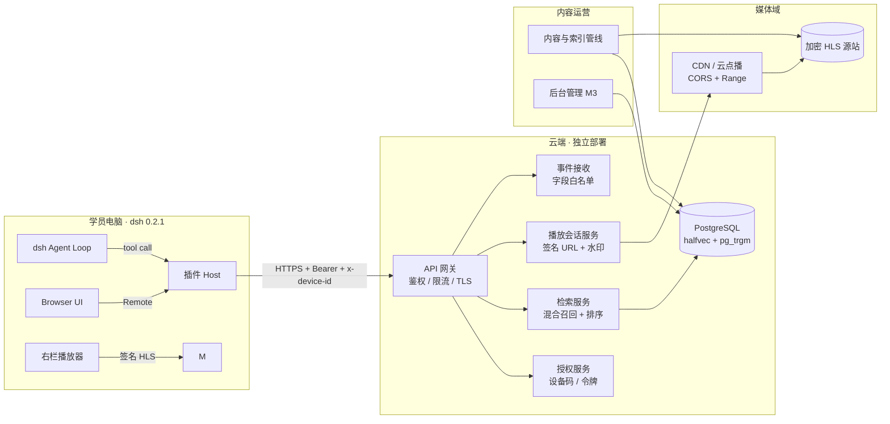
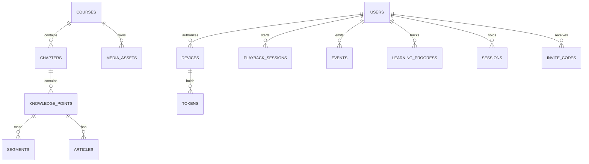
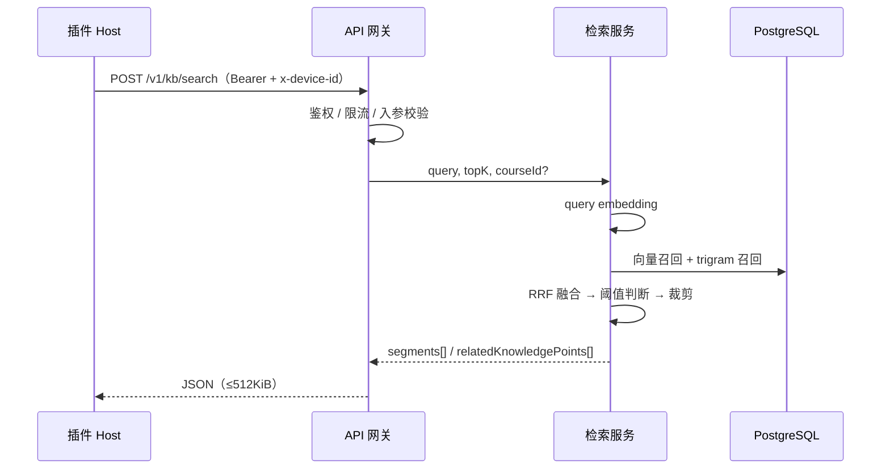
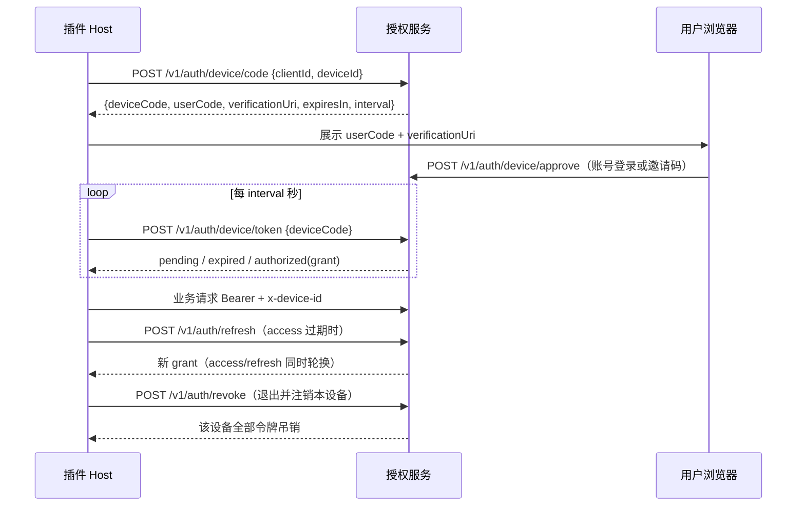

# 趋势课程云端服务 · 架构设计（v0.1）

版本：v0.1（2026-10-31）
状态：初稿。接口口径以插件 PRD v1.3 §6、插件架构 §6/§9/§10/§12 与 [对接清单](./cloud-service-integration-checklist.md) 为准；冲突时先改那两份文档，再同步本文。

## 1. 目标与范围

云端为 `dsh-plugin-trend-coach` 提供**课程知识与内容服务**，不承担推理（学员 BYOK）。

| 提供 | 不提供 |
|---|---|
| Top-K 片段检索（混合召回 + 排序） | 大模型推理 / API Key 托管 |
| 片段元数据与权威起止秒 | 全库正文下发 |
| 短时效签名 HLS 播放会话 | 直链 / 可下载源站地址 |
| 设备码授权与令牌轮换 | 写接口（一期只读） |
| 鉴权指标事件接收（M2） | 第三方分析 SDK |
| 内容与索引管线（M1） | 后台管理（M3 预留） |

**不耦合 `ai-invest`**：独立仓库、独立数据库、独立鉴权与用户体系；不复制其代码、数据或评估集，只借鉴 PostgreSQL `halfvec` + `pg_trgm` + RRF 的技术选型（PRD D2）。

## 2. 设计原则与约束

1. **业务面边界**：学员只读知识内容，仅学习进度与事件同意为学员写操作；账号与内容管理走 `/v1/admin/*`，只接受 operator/admin 会话。
2. **凭据不落地到浏览器**：Bearer 只出现在插件 Host 与云端；浏览器只拿签名播放地址。
3. **内容最小外流**：只下发 Top-K 片段与元数据，不下发全库正文、可下载源站地址。
4. **契约先行**：接口字段、边界与错误码先写进需求与对接清单，再改实现与 OpenAPI。
5. **边界即防线**：入参与响应均按白名单校验；结构不合法整体失败，不静默截断。
6. **可降级但不伪装**：服务不可用时返回结构化错误，绝不返回“无结果”或伪造引用。

## 3. 系统上下文



**职责边界**

| 组件 | 负责 | 不负责 |
|---|---|---|
| API 网关 | TLS、路由、鉴权中间件、限流、错误映射、日志脱敏 | 业务语义 |
| 授权服务 | 设备码、令牌签发与轮换、设备绑定、吊销 | 学员内容权限（M3） |
| 检索服务 | 查询 embedding、混合召回、RRF、阈值、响应裁剪 | 全库正文、模型调用 |
| 播放会话服务 | 片段到媒体路径映射、签名 URL、并发与设备绑定 | 视频转码 |
| 事件接收 | 白名单校验、同意检查、幂等写入 | 第三方 SDK |
| 内容管线 | 转写对齐、切分、索引、发布 | 学员侧读写 |

## 4. 总体架构

### 4.1 分层

```
Client (插件 Host / Browser)
   │ HTTPS
API Gateway ── 鉴权（Bearer + x-device-id）── 限流 ── 请求校验 ── 审计日志
   │
   ├── auth   : device/code → device/token → refresh
   ├── kb     : search / segments/:id
   ├── playback: sessions（签名 playlistUrl）
   └── events : GET/PUT /v1/events/consent + POST /v1/events（白名单）
   │
PostgreSQL ── 课程 / 章节 / 知识点 / 片段 / 向量 / 用户 / 设备 / 令牌 / 事件
对象存储 + CDN ── 加密 HLS（m3u8 / key / 分片）
```

- 单仓库、单服务进程起步（模块化单体），按接口前缀拆模块；M3 再按负载拆服务。
- 检索与播放在同一进程内共享鉴权与限流；媒体流量经 CDN，不经业务进程。
- OpenAPI 3 为唯一契约源，生成请求/响应校验与契约测试夹具。

### 4.2 部署形态

| 环境 | 用途 | 要求 |
|---|---|---|
| staging | 契约测试、插件联调、索引试跑 | 独立数据库与媒体桶；可用测试账号 |
| production | 学员使用 | 有效 TLS；备份与告警 |
| local | 开发与 mock 对齐 | Docker Compose：PostgreSQL + 对象存储 + 服务 |

- 两个环境严格隔离数据库、对象存储桶、令牌密钥与 CDN 配置。
- 签名密钥、数据库口令、CDN 密钥通过环境变量/密钥管理注入，不入库、不入镜像。

## 5. 数据模型



| 表 | 关键字段 | 不变量 |
|---|---|---|
| `courses` | `course_id`、`title`、`status` | `course_id` ≤64、`[A-Za-z0-9._-]`；仅 `published` 可检索 |
| `chapters` | `chapter_id`、`course_id`、`title`、顺序 | `(course_id, chapter_id)` 唯一 |
| `knowledge_points` | `knowledge_point_id`、`chapter_id`、`title` | 转写、文章、片段共用同一 ID |
| `segments` | `segment_id`、`course_id/chapter_id/knowledge_point_id`、`start_sec`、`end_sec`、`text`、`embedding halfvec`、`tsv`、`status` | `segment_id` 全局唯一、跨版本稳定；`start_sec < end_sec` 整数秒；下架 `status` 使 GET 返回 404 |
| `media_assets` | `asset_id`、`course_id`、`hls_path`、`encryption` | 不对外暴露源站直链 |
| `users` | `user_id`、`username`、`display_name`、`role`、`status`、`password_hash`、`events_consent` | 账号由管理员创建；`username` 唯一且小写；密码只存 scrypt 哈希；禁用立即拒绝令牌 |
| `sessions` | `token_hash`、`user_id`、`expires_at`、`revoked_at`、`last_seen_at` | 后台会话与设备令牌分离；只存哈希；改密/禁用/角色变更即吊销 |
| `invite_codes` | `code_hash`、`user_id`、`expires_at`、`consumed_at`、`created_by` | 单次使用；只存哈希；新建邀请码使旧码失效；默认 7 天 |
| `devices` | `device_id`、`user_id`、首次授权时间、状态 | `device_id` 由插件首启生成并持久绑定 |
| `tokens` | `token_hash`、`kind(access/refresh)`、`device_id`、`expires_at`、`revoked_at`、`rotated_from` | 只存哈希；旧 refresh 轮换后立即失效 |
| `playback_sessions` | `session_id`、`user_id`、`device_id`、`segment_id`、`expires_at`、状态 | 绑定设备；并发受配额约束 |
| `events` | `event_name`、`user_id`、`device_id_hash`、白名单字段、时间 | 无 query 原文、回答内容、完整播放地址 |
| `articles`（M3 已落地） | `knowledge_point_id`、`markdown`、`version`、`status`、`published_at` | 仅 `published` 下发；单篇 ≤20000 字符，仅 Markdown 子集；每次保存 `version + 1`，发布时写 `published_at` |
| `learning_progress`（M3 已落地） | `user_id`、`device_id`、`knowledge_point_id`、`watched_sec`、`completed`、`updated_at` | `(user_id, knowledge_point_id)` 唯一；`watched_sec` 取最大值；`completed` 不回退 |

建库插件：`pgvector`（`halfvec`）、`pg_trgm`；检索索引与向量索引分离于业务表，可在线重建（M3 后台触发）。

`learning_progress` 按用户聚合、以 `device_id` 记录最后写入设备，进度写入不进入 `events`；`articles` 与账号/后台表分阶段迁移。

## 6. 检索管线

### 6.1 离线索引

```
录播视频 + 带时间戳转写 + 课程文章 + 片段映射
  → 按知识点/语义切分（秒级映射）
  → 片段文本清洗与长度控制（建议 ≤2KB，超限截断并标记）
  → embedding（云端模型）→ halfvec
  → trigram 词项 → GIN(pg_trgm)
  → 写入 segments（草稿）→ 审核 → status=published → 进入召回
```

- 发布与索引分离：未审核内容不进入检索。
- 索引任务记录状态（`queued/running/succeeded/failed`）与耗时，失败可重跑。
- 重建时双写新索引版本，切换后再清理旧版本。

### 6.2 在线检索



1. **向量召回**：`halfvec` 余弦距离，取 `topN = max(topK × 4, 20)`。
2. **词法召回**：`pg_trgm` 相似度 + 关键词命中，取 `topN`。
3. **融合**：RRF（`k` 为可调参数，默认 60）；同片段去重。
4. **阈值与回退**：召回阈值（`SEARCH_MIN_SIMILARITY`，默认 0.05）只负责捞候选；引用置信阈值（`SEARCH_MIN_CONFIDENCE`，默认 0.15）过滤单个 trigram 级别的偶然命中（如短 query 与标题补位字符重合）。过滤后为空即按未覆盖处理，填充 `relatedKnowledgePoints`（同一置信阈值、≤5、仅 `knowledgePointId/title`，**不带起止秒与正文**）。两个阈值都需在评估集上校准。
5. **裁剪**：输出 Top-K；`score` 归一化到 `[0,1]`；字段与长度按契约校验；整体超出 512KiB 报错而非截断。

**质量门槛**：自建评估集 ≥100 条真实学员问题，Top-5 命中率 ≥90%；每次索引或排序变更都必须跑回归。

### 6.3 输入校验

| 字段 | 规则 | 越界 |
|---|---|---|
| `query` | 去首尾空白后 1–500 字符 | `400` |
| `topK` | 整数 1–20，默认 5 | `400` |
| `courseId` | 可选，≤64，`[A-Za-z0-9._-]` | `400` |
| `segmentId` | `^seg-[A-Za-z0-9._-]+$`，≤80 | `400` / 不存在 `404` |

## 7. 鉴权与会话

### 7.1 设备码流程



- `clientId` 固定 `dsh-plugin-trend-coach`；`deviceId` 由插件首启随机生成并持久绑定。
- 令牌只存哈希（如 SHA-256），刷新校验 `deviceId` 是否匹配；不匹配 `403`。
- access 过期 `401`；插件自动刷新一次后仍失败则提示重新授权。
- 注销由 `POST /v1/auth/revoke` 完成：吊销本设备全部 access/refresh 并置 `devices.status = revoked`，同账号其它设备不受影响；重新授权可恢复。管理员可禁用账号（`PATCH /v1/admin/users/{id}`），禁用后设备令牌与后台会话均立即拒绝；不提供物理删除。
- 批准必须绑定已存在账号：学员提交用户名密码，或邀请码 + 新密码；运营/管理员可用后台会话代批并指定 `userId`。共享控制台令牌已移除。
- 设备批准一旦完成，设备与账号绑定固定；换账号需先注销再用目标账号授权。

### 7.2 账号与后台会话（M3.1）

- 账号由管理员创建：`username`（小写、唯一）、`displayName`、`role`（student/operator/admin）、可选初始密码或一次性邀请码。
- 密码用随机盐 scrypt 存储（N=16384、r=8、p=1、64 字节），比较使用常量时间；登录失败、邀请码错误与禁用账号统一返回 `401`。
- 后台会话 `POST /v1/auth/session` 只对 operator/admin 开放；令牌 12 小时默认、只存 SHA-256 哈希；注销、改密、禁用与角色变更即吊销。
- 邀请码默认 7 天、单次使用；相同账号新建邀请码会使未使用旧码失效；服务端只存哈希，明文只在创建响应出现一次。
- 首个管理员由启动配置创建（`BOOTSTRAP_ADMIN_USERNAME` / `BOOTSTRAP_ADMIN_PASSWORD`），仅当库中不存在 active admin 时生效。
- 角色边界：学员令牌只能访问业务接口；`/v1/admin/*` 读接口要求 operator/admin，账号写接口仅 admin；禁止管理员禁用或降级自己，禁止移除最后一个 active admin。

### 7.3 鉴权中间件

- 业务接口统一校验 `Authorization: Bearer` 与 `x-device-id`，并核对令牌所属设备。
- 后台接口校验后台会话 Bearer（不带 `x-device-id`），按角色放行；学员设备令牌不可访问后台。
- 失败语义：缺失/过期 `401`；设备不匹配或角色不足 `403`。

### 7.4 内容管理接口与控制台（M3.2）

- 内容写接口位于 `/v1/admin/content/*`，要求 operator/admin 会话；课程、章节、知识点、文章、片段均支持创建与修改，发布/归档通过 `status` 切换，不提供物理删除。
- 文章 `PUT` 为幂等 upsert：每次成功保存 `version + 1`、`updated_at = now()`；`status=published` 时写 `published_at`。Markdown 在服务端校验为纯 Markdown 子集，拒绝 `<script>`、`<iframe>`、事件属性与 `javascript:` 等可执行内容。
- 片段写入校验 `startSec < endSec`、标题/文本长度与知识点归属；文本变更时清空 `embedding`，避免旧向量参与检索，需通过 `POST /v1/admin/content/reindex` 重建。
- 学员可见性由现有查询保证：课程非 `published`、片段或文章非 `published` 时不下发；后台写入不影响已签发的播放会话，但新会话需片段仍可用。
- 控制台为 `/admin` 单页应用（Vite + React），构建产物由 Fastify 静态托管；会话令牌存 `sessionStorage`，不使用 cookie，静态页不缓存；所有数据请求仍走 `/v1/auth/session` + 后台接口逐请求鉴权。
- 账号管理页仅 admin 可见；operator 登录后仅显示内容管理，接口层同时校验角色，前端隐藏不作为安全边界。

## 8. 播放与媒体

- `POST /v1/playback/sessions` 校验片段可播与用户配额后，返回短时效签名 `playlistUrl`（绑定设备与会话）。
- m3u8 内 **key URI 与所有分片地址携带同一 token**；浏览器直接向媒体域取流，不携带 Bearer。
- 媒体域必须：
  - 允许 CORS（至少 `GET/OPTIONS`、`Range`、`Content-Type`）；
  - 支持 HTTP Range（206）；
  - 拒绝过期/无效 token，返回 `403` 且为可被播放器识别的响应。
- `expiresAt` ≥ 单片段播放窗口 60s，推荐 5–10 分钟；过期后由插件重新换取会话。
- 并发按用户/设备限制；超限拒绝并提示。
- `watermark.label` 仅含非敏感用户标识；客户端渲染动态覆盖层（插件侧 A11）。
- 加密方案（云点播私有加密 / AES-128）需与插件 hls.js 配置对齐，见 PRD §9。

## 9. 安全与隐私

| 面 | 措施 |
|---|---|
| 传输 | 全站 HTTPS；媒体域同样 TLS |
| 凭据 | 设备令牌与会话令牌只存哈希；密码只存带盐 scrypt；签名密钥与 CDN 密钥走密钥管理；不在日志、响应、镜像中出现 |
| 账号 | 管理员创建账号；角色最小权限；学员不可访问后台；禁用/改密吊销会话，禁用即时拒绝设备令牌 |
| 内容 | 只下发 Top-K；播放地址短时效、设备绑定、并发限制；不提供下载直链 |
| 内容管理 | `/v1/admin/content/*` 仅 operator/admin 会话；Markdown 拒绝可执行 HTML/脚本；发布状态即时影响学员可见性 |
| 输入 | 白名单校验 + 长度/体积上限；拒绝非 JSON 与超大请求 |
| 日志 | 不记 token、完整 query、完整 deviceId；需要排障时用截断前缀或哈希 |
| 隐私 | 数据最小化；事件需同意且可撤回；支持数据删除 |
| 依赖 | 定期审计；生产不使用第三方分析 SDK |

## 10. 可观测性

| 类别 | 指标 |
|---|---|
| 检索 | QPS、P50/P95/P99、空召回率、`relatedKnowledgePoints` 命中、响应体积 |
| 授权 | 设备码发起/批准/过期、刷新成功/失败、401/403 分桶 |
| 播放 | 会话签发量、签名失败率、并发、CDN 命中率、起播耗时（端上报） |
| 系统 | 错误率按 `400/401/403/404/429/5xx` 分桶、限流命中、DB 连接/慢查询、索引任务耗时与失败 |
| 事件 | 接收量、白名单拒绝量、同意/撤回状态 |

- 日志结构化，带 `request_id`；响应返回 `request_id` 便于排障（不泄露内部细节）。
- 告警：5xx/429 异常升高、检索 P95 超阈值、索引任务连续失败、证书到期、签名失败率异常。

## 11. 性能与容量

- 检索 P95 ≤300ms（云端侧，不含网络与模型推理）。
- 视频起播 ≤2s（CDN）；HLS 分片支持 Range 与 seek。
- 可用性 ≥99.5%；staging/production 分离。
- 容量按并发检索与视频并发分别评估；CDN 承担媒体带宽，业务进程不代理媒体流。
- 数据库连接池与索引（`halfvec` ANN、`pg_trgm` GIN）随数据量调优；NFR 以压测结论为准。

## 12. 测试与验收

| 层 | 内容 |
|---|---|
| 契约测试 | 覆盖对接清单 §6 全部用例：授权、检索、片段、播放、限流、错误语义 |
| 单元/集成 | 入参校验、RRF 融合、阈值回退、签名 URL 构造与校验、令牌轮换 |
| 检索质量 | 自建评估集 ≥100 条，Top-5 ≥90% |
| 媒体 | 加密 HLS 可解密、seek、Range 206、CORS、token 过期提示 |
| 安全 | 越权/设备不匹配/过期令牌、日志脱敏抽查、限流 |
| 压测 | 检索 P95 与并发目标；播放会话签发与 CDN 并发 |

CI 必跑：类型检查、单元测试、契约测试（对 staging 或本地 compose）、OpenAPI 与实现一致性校验。

## 13. 里程碑

| 阶段 | 交付 | 出口标准 |
|---|---|---|
| M1 | 内容管线、课程/知识点/片段入库、索引 | 1 门真实课程结构化上线，可检索 |
| M2 | 核心业务接口、设备码授权、签名 HLS、事件接口与同意管理、契约测试 | 对接清单验收通过，插件联调完成 |
| M3 | 后台管理、账号体系、学习进度、索引重建/召回测试 | 内容可运营、用户可管理 |
| M6 | 限流、压测、备份、合规加固 | 公测放行 |

实现状态（2026-10-31）：M2 服务侧已落地——核心业务接口、设备码授权与令牌轮换、`POST /v1/auth/revoke` 设备注销、签名 HLS 会话、事件白名单与幂等、`GET/PUT /v1/events/consent` 同意读写、OpenAPI 与契约测试；限流为单实例内存实现。M3.3 体系与进度接口（课程列表、课程树、知识点详情、进度上报）已落地；M3.1 账号与后台登录（管理员创建账号、邀请码、会话、角色、设备批准绑定）已落地；内容管线（M1）与 React 管理端（M3.2）、内容管理接口（M3.2）未实现，TTL 与并发上限仍为临时默认值。

## 14. 关键设计决策（ADR）

| 编号 | 决策 | 理由 | 代价 |
|---|---|---|---|
| C1 | 独立仓库与独立数据库，不复用 `ai-invest` | 用户体系、内容与合规边界独立；避免隐式耦合 | 需自建管线、鉴权与评估集 |
| C2 | PostgreSQL `halfvec` + `pg_trgm` + RRF 混合检索 | 单库完成向量与词法召回，运维简单；对中文短查询鲁棒 | 需调优索引与 RRF 参数；超大规模后评估专用向量库 |
| C3 | 只读业务接口 + Top-K | 降低内容外流与越权面 | 离线不可用；功能受限 |
| C4 | 设备码授权 + 双令牌轮换 | 无浏览器回调依赖，适配桌面插件；缩短令牌暴露窗口 | 多一个授权页与轮换状态机 |
| C5 | 播放地址由业务接口签发，浏览器不持 Bearer | 凭据留在 Host；签名 URL 可绑定设备、并发、时效 | 会话 TTL 与重换取逻辑 |
| C6 | 媒体走 CDN，不经业务进程 | 带宽与成本可控；业务面保持轻量 | 需 CDN 签名/CORS/Range 配置一致性 |
| C7 | 事件白名单 + 同意可撤回 | 隐私合规；避免第三方 SDK 与原始 query 外流 | 指标体系受限，需要同意管理 |
| C8 | 模块化单体起步 | M1/M2 以交付速度优先；接口前缀已分层 | M3 后需按负载拆分服务 |

## 15. 开放问题

1. access/refresh TTL、并发设备上限、主动吊销与多设备策略（PRD §9）。
2. 片段长度与注入策略：建议单片段 ≤2KB、总 ≤12KB；当前插件按 4KB/512KiB 校验，需一致化。
3. 事件端点与同意模型：建议 `POST /v1/events`，默认关闭、可撤回。
4. 视频加密方案：云点播私有加密 vs AES-128，需与 hls.js 解密配置对齐。
5. 相邻知识点阈值：空召回或最高分低于阈值的具体数值待评估集定标。
6. 引用 host：`trend-coach.local` 是否长期保留；真实域名需插件同步支持。
7. 部署区域与 CDN 供应商：影响签名算法、CORS 配置与延迟预算。

## 16. 关联文档

- [云端服务对接清单](./cloud-service-integration-checklist.md)
- [云端服务需求](../requirements/product-requirements.md)
- [项目规范](../conventions/project-conventions.md)
- 插件仓库：`../dsh-plugin-trend-coach`（PRD v1.3 §6、架构 v1.2 §6/§9/§10/§12）
