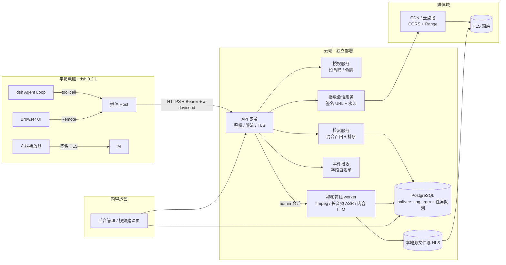
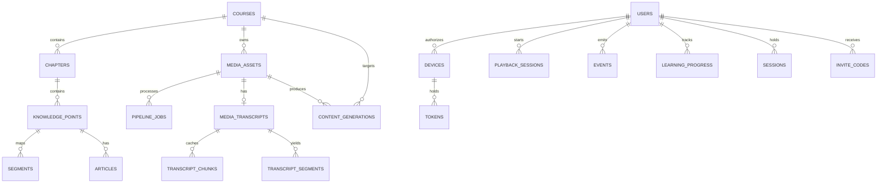
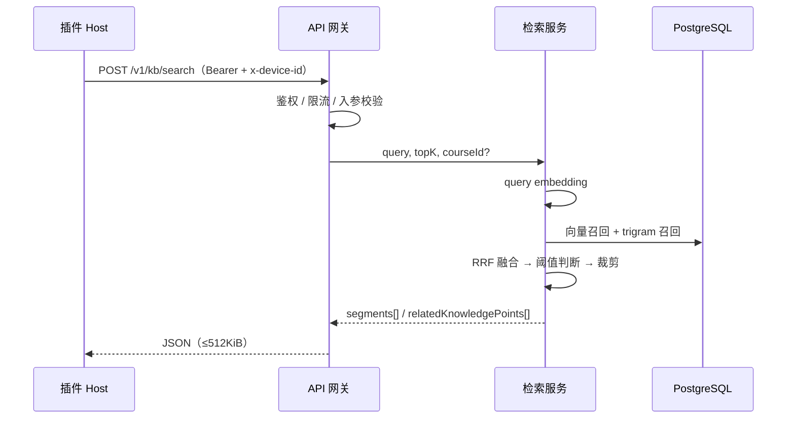
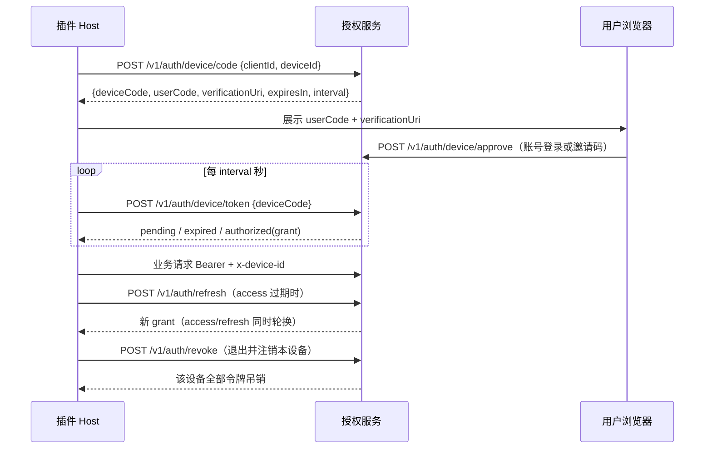

# 趋势课程云端服务 · 架构设计（v0.5）

版本：v0.5（2026-11-01）
状态：初稿。接口口径以插件 PRD v1.6 §6、插件架构 §6/§9/§10/§12 与 [对接清单](./cloud-service-integration-checklist.md) 为准；冲突时先改那两份文档，再同步本文。v0.5 补充 M6 公测加固（限流矩阵、内存上限、压测与恢复演练、合规基线）；v0.4 新增 M1 视频→课程管线（本地存储、DB 任务队列、长音频转写、LLM 草稿与人工发布）；v0.3 同步 M3.1/M3.2/M3.3 落地状态；v0.2 新增 M4.2 语音转写（MiniMax ASR）。

## 1. 目标与范围

云端为 `dsh-plugin-trend-coach` 提供**课程知识与内容服务**，不承担推理（学员 BYOK）。

| 提供 | 不提供 |
|---|---|
| Top-K 片段检索（混合召回 + 排序） | 大模型推理 / API Key 托管 |
| 片段元数据与权威起止秒 | 全库正文下发 |
| 短时效签名 HLS 播放会话 | 直链 / 可下载源站地址 |
| 设备码授权与令牌轮换 | 学员侧内容写接口（一期只读） |
| 鉴权指标事件接收（M2） | 第三方分析 SDK |
| 语音转写（M4.2，MiniMax ASR，仅语音→文字） | 学员侧生成式推理 |
| 后台账号、内容管理与索引重建（M3） | 召回评估看板、插件版本与灰度 |
| 视频→课程管线（M1）：流式上传、单码率 HLS、长音频转写、章节/知识点/片段切分、文章草稿、人工发布 | 多码率 ABR、对象存储、断点续传、自动发布 |

**不耦合 `ai-invest`**：独立仓库、独立数据库、独立鉴权与用户体系；不复制其代码、数据或评估集，只借鉴 PostgreSQL `halfvec` + `pg_trgm` + RRF 的技术选型（PRD D2）。

**模型能力边界**：云端只允许 ASR、查询 embedding 与管理端内容生产 LLM。前两者在请求生命周期内调用；内容 LLM 仅由 `operator/admin` 触发，产物只落 `draft`，必须人工审核并显式发布。连接信息与密钥存数据库（AES-256-GCM 加密），仅 `admin` 在后台维护；明文密钥不进入浏览器、插件、日志或响应。

## 2. 设计原则与约束

1. **业务面边界**：学员只读知识内容，仅学习进度与事件同意为学员写操作；账号与内容管理走 `/v1/admin/*`，只接受 operator/admin 会话。
2. **凭据不落地到浏览器**：Bearer 只出现在插件 Host 与云端；浏览器只拿签名播放地址。
3. **内容最小外流**：只下发 Top-K 片段与元数据，不下发全库正文、可下载源站地址。
4. **契约先行**：接口字段、边界与错误码先写进需求与对接清单，再改实现与 OpenAPI。
5. **边界即防线**：入参与响应均按白名单校验；结构不合法整体失败，不静默截断。
6. **可降级但不伪装**：服务不可用时返回结构化错误，绝不返回“无结果”或伪造引用。
7. **生成必须人审**：内容 LLM 只产出草稿，apply 与 publish 都是显式人工操作；发布前同步索引，失败不翻状态。

## 3. 系统上下文



**职责边界**

| 组件 | 负责 | 不负责 |
|---|---|---|
| API 网关 | TLS、路由、鉴权中间件、限流、错误映射、日志脱敏 | 业务语义 |
| 授权服务 | 设备码、令牌签发与轮换、设备绑定、吊销 | 学员内容权限（M3） |
| 检索服务 | 查询 embedding、混合召回、RRF、阈值、响应裁剪 | 全库正文、模型调用 |
| 播放会话服务 | 片段到媒体路径映射、签名 URL、并发与设备绑定 | 视频转码 |
| 事件接收 | 白名单校验、同意检查、幂等写入 | 第三方 SDK |
| 视频管线（M1） | 上传落盘、ffprobe/ffmpeg、长音频转写、切分草稿、任务编排、人工发布与索引 | 学员侧读写、自动发布 |
| 本地媒体存储 | 源文件、工作区、HLS 的原子发布与清理 | 对外暴露路径或直链 |

## 4. 总体架构

### 4.1 分层

```
Client (插件 Host / Browser)
   │ HTTPS
API Gateway ── 鉴权（Bearer + x-device-id）── 限流 ── 请求校验 ── 审计日志
   │
   ├── auth   : device/code → device/token → refresh
   ├── kb     : search / segments/:id
   ├── playback: sessions（签名 playlistUrl）
   ├── asr     : POST /v1/asr/transcribe → MiniMax speech_to_text（M4.2）
   ├── admin   : /v1/auth/session + /v1/admin/*（后台账号、内容管理、索引重建、视频管线、模型配置，M3/M1/M4.3）
   └── events : GET/PUT /v1/events/consent + POST /v1/events（白名单）
   │
PostgreSQL ── 课程 / 章节 / 知识点 / 片段 / 文章 / 向量 / 用户 / 设备 / 令牌 / 事件 / 后台会话 / 管线任务与转写
本地存储（MediaStore）── 源视频 / 工作区 / HLS；生产 HLS 由 CDN 或对象存储承接
```

- 单仓库、单服务进程起步（模块化单体），按接口前缀拆模块；M3 再按负载拆服务。
- 检索与播放在同一进程内共享鉴权与限流；媒体流量经 CDN，不经业务进程。
- 视频管线 worker 与 API 同进程、默认并发 1，用 PostgreSQL `pipeline_jobs` + `FOR UPDATE SKIP LOCKED` 认领；不引入 Redis/Celery。多实例时认领仍正确，资源竞争后置。
- OpenAPI 3 为唯一契约源，生成请求/响应校验与契约测试夹具。

### 4.2 部署形态

| 环境 | 用途 | 要求 |
|---|---|---|
| staging | 契约测试、插件联调、索引试跑、管线演练 | 独立数据库与媒体目录；可用测试账号；ffmpeg 可用 |
| production | 学员使用 | 有效 TLS；备份与告警；管线存储卷与容量监控 |
| local | 开发与 mock 对齐 | Docker Compose：PostgreSQL + 服务；ffmpeg 可选 |

- 两个环境严格隔离数据库、媒体存储、令牌密钥与 CDN 配置。
- 签名密钥、数据库口令、CDN 密钥通过环境变量/密钥管理注入，不入库、不入镜像；ASR/LLM/embedding 密钥存数据库（后台录入、加密落库），环境只提供 `CREDENTIAL_ENCRYPTION_KEY`。
- 镜像内置 ffmpeg/ffprobe；`PIPELINE_STORAGE_DIR`（源文件与工作区）与 `PIPELINE_HLS_DIR`（对外 HLS）位于同一挂载点（宿主 `workspace/pipeline` 挂到 `/data`），保证 HLS 原子 rename。所有运行期持久化数据按 ai-invest 约定放在仓库根 `workspace/`，整体 gitignore。

## 5. 数据模型



| 表 | 关键字段 | 不变量 |
|---|---|---|
| `courses` | `course_id`、`title`、`status` | `course_id` ≤64、`[A-Za-z0-9._-]`；仅 `published` 可检索 |
| `chapters` | `chapter_id`、`course_id`、`title`、顺序 | `(course_id, chapter_id)` 唯一 |
| `knowledge_points` | `knowledge_point_id`、`chapter_id`、`title` | 转写、文章、片段共用同一 ID |
| `segments` | `segment_id`、`course_id/chapter_id/knowledge_point_id`、`start_sec`、`end_sec`、`text`、`embedding halfvec`、`tsv`、`status` | `segment_id` 全局唯一、跨版本稳定；`start_sec < end_sec` 整数秒；下架 `status` 使 GET 返回 404 |
| `media_assets` | `asset_id`、`course_id`、`title`、`hls_path`、`encryption`、`status`、`source_rel_path`、`source_size_bytes`、`source_sha256`、`duration_ms`、`error_code` | 不对外暴露源站直链；状态 `awaiting_upload/uploaded/processing/ready/failed/archived`；播放只选 `ready`；`source_*` 仅内部使用 |
| `users` | `user_id`、`username`、`display_name`、`role`、`status`、`password_hash`、`events_consent` | 账号由管理员创建；`username` 唯一且小写；密码只存 scrypt 哈希；禁用立即拒绝令牌 |
| `sessions` | `token_hash`、`user_id`、`expires_at`、`revoked_at`、`last_seen_at` | 后台会话与设备令牌分离；只存哈希；改密/禁用/角色变更即吊销 |
| `invite_codes` | `code_hash`、`user_id`、`expires_at`、`consumed_at`、`created_by` | 单次使用；只存哈希；新建邀请码使旧码失效；默认 7 天 |
| `devices` | `device_id`、`user_id`、首次授权时间、状态 | `device_id` 由插件首启生成并持久绑定 |
| `tokens` | `token_hash`、`kind(access/refresh)`、`device_id`、`expires_at`、`revoked_at`、`rotated_from` | 只存哈希；旧 refresh 轮换后立即失效 |
| `playback_sessions` | `session_id`、`user_id`、`device_id`、`segment_id`、`expires_at`、状态 | 绑定设备；并发受配额约束 |
| `events` | `event_name`、`user_id`、`device_id_hash`、白名单字段、时间 | 无 query 原文、回答内容、完整播放地址 |
| `articles`（M3 已落地） | `knowledge_point_id`、`markdown`、`version`、`status`、`published_at` | 仅 `published` 下发；单篇 ≤20000 字符，仅 Markdown 子集；每次保存 `version + 1`，发布时写 `published_at` |
| `learning_progress`（M3 已落地） | `user_id`、`device_id`、`knowledge_point_id`、`watched_sec`、`completed`、`updated_at` | `(user_id, knowledge_point_id)` 唯一；`watched_sec` 取最大值；`completed` 不回退 |
| `pipeline_jobs`（M1） | `job_id`、`asset_id`、`course_id`、`kind(ingest/generate)`、`status`、`stage`、`progress`、`attempts`、`run_after`、`locked_at/by`、`heartbeat_at`、`cancel_requested`、`error_code`、`options` | 同一素材同类型同时仅一个 `queued/running`；心跳超时回收；失败退避重试；取消为协作式 |
| `media_transcripts`（M1） | `transcript_id`、`asset_id`、`job_id`、`status`、`language`、`model`、`duration_ms`、`chunk_count`、`segment_count` | 每素材一份；成功块缓存；全部完成后才写全局片段 |
| `transcript_chunks`（M1） | `transcript_id`、`idx`、`start_ms/end_ms`、`status`、`sentences jsonb`、`attempt` | 块内时间戳为局部毫秒偏移；`(transcript_id, idx)` 唯一；成功块不重复请求 |
| `transcript_segments`（M1） | `transcript_id`、`idx`、`start_ms/end_ms`、`text` | 全局毫秒时间戳、≤30s 分组、1–4000 字符；按 `start_ms` 排序 |
| `content_generations`（M1） | `generation_id`、`asset_id`、`transcript_id`、`course_id`、`job_id`、`status`、`prompt_version`、`model`、计数、`payload jsonb`、`applied_content jsonb` | 每素材仅一个 `draft`；只存预览与待审原因；`apply` 后保留映射；不自动发布 |
| `llm_configs`（M4.3） | `config_id`、`name`、`provider`、`protocol`、`base_url`、`model`、`api_key_encrypted`、`purpose(content/embedding)`、`is_default`、`is_active`、测试状态 | 每个用途最多一个启用默认项（部分唯一索引）；密钥只存密文；embedding 必须 1024 维 |
| `asr_config`（M4.3） | 单行 `id=1`、`provider`、`protocol(minimax/openai)`、`base_url`、`model`、`api_key_encrypted`、`enabled`、测试状态 | 全局唯一渠道；`enabled` 且密钥可解密时才参与转写 |

建库插件：`pgvector`（`halfvec`）、`pg_trgm`；检索索引与向量索引分离于业务表，可在线重建（M3 后台触发）。

`learning_progress` 按用户聚合、以 `device_id` 记录最后写入设备，进度写入不进入 `events`；`articles` 与账号/后台表分阶段迁移。

## 6. 检索管线

### 6.1 离线索引

```
视频上传 → ffprobe 校验 → 单码率 HLS + 16kHz WAV
  → 静音切块 → MiniMax 长音频转写（块级缓存）→ 全局时间戳与 ≤30s 分组
  → 内容 LLM 生成章节/知识点/文章草稿（逐字锚定 + 置信度）
  → 片段由知识点时间窗与转写片段交集确定性生成（≤120s）
  → 人工预览 → apply 写入 draft 课程/文章/片段（embedding=NULL）
  → 显式发布：reindex（配置 embedding 时）→ 文章/片段/课程置 published → 进入召回
```

- 发布与索引分离：未审核内容不进入检索；生成结果只落 `draft`，无自动发布。
- 任务状态（`queued/running/succeeded/failed/canceled`）与阶段耗时入库；失败可重跑且幂等。
- 片段正文提交前清洗与长度控制（1–4000）；超过转写片段边界时拆分，不截断正文。
- embedding 仅在发布前 `reindex` 或管理端手工触发时计算；无 provider 时允许发布但 `indexed=false`（仅词法召回）。
- 详见 §6.4。

### 6.2 在线检索



1. **向量召回**：`halfvec` 余弦距离，取 `topN = max(topK × 4, 20)`。
2. **词法召回**：`pg_trgm` 相似度 + 关键词命中，取 `topN`。
3. **融合**：RRF（`k` 为可调参数，默认 60）；同片段去重。
4. **阈值与回退**：召回阈值（`SEARCH_MIN_SIMILARITY`，默认 0.05）只负责捞候选；引用置信阈值（`SEARCH_MIN_CONFIDENCE`，默认 0.15）过滤单个 trigram 级别的偶然命中（如短 query 与标题补位字符重合）。过滤后为空即按未覆盖处理，填充 `relatedKnowledgePoints`（同一置信阈值、≤5、仅 `knowledgePointId/title`，**不带起止秒与正文**）。两个阈值都需在评估集上校准。
5. **裁剪**：输出 Top-K；`score` 归一化到 `[0,1]`；字段与长度按契约校验；整体超出 512KiB 报错而非截断。

**质量门槛**：自建评估集 ≥100 条真实学员问题，Top-5 命中率 ≥90%；每次索引或排序变更都必须跑回归。

### 6.3 输入校验

| 字段 | 规则 | 越界 |
|---|---|---|
| `query` | 去首尾空白后 1–500 字符 | `400` |
| `topK` | 整数 1–20，默认 5 | `400` |
| `courseId` | 可选，≤64，`[A-Za-z0-9._-]` | `400` |
| `segmentId` | `^seg-[A-Za-z0-9._-]+$`，≤80 | `400` / 不存在 `404` |

### 6.4 视频→课程管线（M1）

#### 存储布局与抽象

```text
workspace/pipeline/            # 容器内挂载为 /data
  storage/                     # PIPELINE_STORAGE_DIR
    sources/<assetId>/source
    work/<assetId>/{audio.wav,chunks/,hls/}
  hls/                         # PIPELINE_HLS_DIR
    hls/<assetId>/{index.m3u8,seg_00000.ts}
```

- `MediaStore` 接口负责创建目录、流式写、SHA-256、原子 rename、清理与 HLS 校验；当前实现为本地文件系统，预留 S3/MinIO。
- 设置 `MEDIA_LOCAL_DIR` 时要求 `PIPELINE_HLS_DIR` 与其解析后相等，否则启动失败；源目录不得位于媒体根下。
- 存储目录与 HLS 目录必须同卷，HLS 从 `work/<assetId>/hls` 原子 rename 到 `PIPELINE_HLS_DIR/hls/<assetId>`；跨卷时启动或运行失败，不做复制降级。
- `media_assets.hls_path = 'hls/<assetId>/index.m3u8'`；播放签名前缀自然限定到该目录，源文件永不进入签名范围。

#### 上传与媒体校验

- `PUT /v1/admin/content/media-assets/{assetId}/source` 只接受 `application/octet-stream`，路由级 `bodyLimit = PIPELINE_MAX_UPLOAD_BYTES`（默认 2GiB）；在作用域内注册流解析器，`preParsing` 先完成会话鉴权与限流再消费 body。
- 可选 `x-file-sha256`（64 位小写 hex）；流式计算 SHA-256，不符返回 `400` 并删除半成品。超限 `413`，类型不符 `415`。
- 上传写临时文件，完成后原子 rename 为 `sources/<assetId>/source`，素材状态 `awaiting_upload → uploaded`；重复上传覆盖旧源文件并重置转写/生成。
- `ffprobe -v error -print_format json -show_format -show_streams`：必须同时存在视频流与音频流；时长 >0 且 ≤ `PIPELINE_MAX_SOURCE_SECONDS`（默认 14400s）；失败 `422`，只返回稳定 `error_code`。

#### ffmpeg 参数

```bash
# HLS：单码率 H.264/AAC，6s 分片，VOD
ffmpeg -y -i source \
  -c:v libx264 -preset veryfast -crf 23 -pix_fmt yuv420p -vf "scale='min(1280,iw)':-2" \
  -c:a aac -b:a 128k -ar 48000 \
  -f hls -hls_time 6 -hls_playlist_type vod -hls_segment_filename 'seg_%05d.ts' \
  -progress pipe:1 index.m3u8

# 16kHz 单声道 PCM16
ffmpeg -y -i source -vn -ac 1 -ar 16000 -c:a pcm_s16le audio.wav

# 静音检测（只读 stderr）
ffmpeg -y -i audio.wav -af silencedetect=noise=-30dB:d=0.5 -f null -

# 切块
ffmpeg -y -ss <start> -t <duration> -i audio.wav -c:a pcm_s16le chunk.wav
```

- 一律 `spawn(FFMPEG_PATH, args)`，禁止 shell；启用时启动探活 `-version`（5s），缺失则启动失败。
- 进度解析 `-progress pipe:1` 的 `out_time_ms`，上限 100；超时 `PIPELINE_FFMPEG_TIMEOUT_MS` / `PIPELINE_AUDIO_TIMEOUT_MS`。
- 取消时 `SIGKILL` 子进程并清理工作区；stderr 只保留内部日志，不返回客户端。
- 发布前校验 `#EXT-X-ENDLIST` 存在、playlist 中全部分片存在且非空，再原子 rename。

#### 长音频转写

- 静音检测得到切点，按 ≤480s 切块，最多 `PIPELINE_ASR_CONCURRENCY`（默认 2）并发；每块独立缓存，成功块重跑直接复用，避免重复计费。
- MiniMax `POST {base}/v1/speech_to_text`：multipart `file=chunk.wav`、`model`、`response_format=verbose_json`、`timestamp_level=sentence`；解析器兼容 `sentences/segments/utterances` 与多种时间键。
- 每块最多 3 次重试（429/5xx/网络），退避后仍失败则该块 `failed`；无时间戳时退化为“整块一句话”，并在转写元数据标 `timestamp_fallback`。
- 全部块完成后单事务拼接：块内局部毫秒 + 块起点 → 全局时间戳，丢弃空白/重叠，按 ≤30s 分组写 `transcript_segments`；时间戳必须单调不重叠。
- 转写正文只存数据库；仅 `GET .../transcript` 返回管理端，日志/指标不记正文。

#### 任务编排

```
queued ──claim──> running ──success──> succeeded
   │                  ├──retryable failure──> queued（退避 15s/60s/300s + 抖动）
   │                  ├──terminal failure───> failed
   └──cancel──> canceled          └──cancel_requested──> canceled
```

- ingest 阶段 `probe → transcode → transcribe → finalize → done`；generate 阶段 `structure → generate → finalize → done`。
- worker 默认并发 1、轮询 2s；`SELECT ... FOR UPDATE SKIP LOCKED` 认领到期任务，认领即 `attempts+1`、写 `locked_*` 与心跳。
- 心跳默认 10s；启动时与每 30s 回收 `heartbeat_at < now()-PIPELINE_STALE_JOB_MS`（默认 120s）的 `running` 任务，置回 `queued` 或 `failed`（attempts 用尽）。
- 重试仅针对可重试错误（网络、上游 429/5xx、ffmpeg 超时）；参数/媒体非法为终态失败。`error_code` ≤64，客户端只看到稳定码与静态文案。
- 取消：`queued` 立即 `canceled`；`running` 置 `cancel_requested`，worker 在阶段边界检查、中止 fetch、`SIGKILL` ffmpeg；已产生的块缓存与转写保留供重试。
- 幂等：已探测时长复用；已提升的合法 HLS 跳过转码；成功转写块复用；生成结果一次性写；apply 二次调用返回原映射。

#### 内容生成

- 以 600s 窗口切分转写，重叠 30s 或一个转写片段，最多 24 窗口；超预算直接失败 `generation_budget_exceeded`，不部分落库。
- 每窗口一次章节调用（1–6 个有序章节，跨窗口按归一化标题合并）与一次知识点调用（≤8 个 `{title,excerpt,chapterTitle,confidence}`）。
- `excerpt` 必须在窗口转写中逐字锚定（归一化空白/标点后匹配）；不匹配保留但标 `excerpt_not_found`，无法定位时间的丢弃；`confidence < GENERATION_MIN_CONFIDENCE`（0.6）标 `low_confidence`；按标题去重。
- 片段由知识点时间窗与转写片段交集确定性生成，每段 ≤120s/4000 字，超限在转写片段边界拆分。
- 每知识点一次文章调用，只使用该知识点转写，输出 `{markdown}`；复用安全 Markdown 校验与 20000 字上限；失败重试一次，仍失败标 `article_invalid`、`articleMarkdown=null`，不阻塞其它内容。
- 生成结束一次性写 `content_generations`（`status=draft`，`prompt_version=m1-v1`，`payload` 含章节/知识点/片段/文章草稿与待审原因）。预览接口不返回文章与片段正文。

#### Apply 与发布

- `POST /generations/{generationId}/apply`：仅 `draft` generation、`draft` 课程且课程无章节/知识点/片段；否则 `409`。
- 确定性 ID：`ch_<hash8>_<chapterKey>`、`kp_<hash8>_<pointKey>`、`seg-<hash8>-<segmentKey>`，`hash8 = sha256(generationId)` 前 8 位小写 hex。
- 单事务：章节 → 知识点 → 文章（`draft`，`version=1`）→ 片段（`draft`，`embedding=NULL`）→ 写 `applied_content` → generation `applied`；任一步失败整体回滚。
- `POST /courses/{courseId}/publish`：课程非 `archived` 且至少 1 个片段；配置 embedding 时先同步 `reindex(courseId)`，失败 `503` 且不翻状态；随后单事务把 `draft` 文章/片段置 `published`（文章补 `published_at`）、课程置 `published`；幂等，返回 counts 与 `indexed/embedded`。
- 无 embedding provider 时允许发布，`indexed=false`（仅词法召回）；生成内容绝不自动进入检索。

#### 错误映射

| 状态 | 场景 |
|---|---|
| `400` | 参数/ID/游标非法；SHA 不符 |
| `401/403` | 未登录；角色不足或设备不匹配 |
| `404` | 素材/任务/生成/课程不存在 |
| `409` | 状态不允许（重复 ingest、非 draft apply、课程已有内容） |
| `413/415` | 上传超限；Content-Type 非 octet-stream |
| `422` | 媒体无音轨/超时长/损坏；源文件缺失 |
| `429` | 管线接口限流 |
| `503` | 管线未启用、ffmpeg 不可用、ASR/LLM/embedding 未配置 |

## 7. 鉴权与会话

### 7.1 设备码流程



- `clientId` 固定 `dsh-plugin-trend-coach`；`deviceId` 由插件首启随机生成并持久绑定。
- 令牌只存哈希（如 SHA-256），刷新校验 `deviceId` 是否匹配；不匹配 `403`。
- access 过期 `401`；插件自动刷新一次后仍失败则提示重新授权。
- 注销由 `POST /v1/auth/revoke` 完成：吊销本设备全部 access/refresh 并置 `devices.status = revoked`，同账号其它设备不受影响；重新授权可恢复。管理员可禁用账号（`PATCH /v1/admin/users/{id}`），禁用后设备令牌与后台会话均立即拒绝；不提供物理删除。
- 批准必须绑定已存在账号：学员提交用户名密码，或邀请码 + 新密码；运营/管理员可用后台会话代批并指定 `userId`。共享控制台令牌已移除。
- 设备批准一旦完成，设备与账号绑定固定；换账号需先注销再用目标账号授权。

### 7.2 账号与后台会话（M3.1）

- 账号由管理员创建：`username`（小写、唯一）、`displayName`、`role`（student/operator/admin）、可选初始密码或一次性邀请码。
- 密码用随机盐 scrypt 存储（N=16384、r=8、p=1、64 字节），比较使用常量时间；登录失败、邀请码错误与禁用账号统一返回 `401`。
- 后台会话 `POST /v1/auth/session` 只对 operator/admin 开放；令牌 12 小时默认、只存 SHA-256 哈希；注销、改密、禁用与角色变更即吊销。
- 邀请码默认 7 天、单次使用；相同账号新建邀请码会使未使用旧码失效；服务端只存哈希，明文只在创建响应出现一次。
- 首个管理员由启动配置创建（`BOOTSTRAP_ADMIN_USERNAME` / `BOOTSTRAP_ADMIN_PASSWORD`），仅当库中不存在 active admin 时生效。
- 角色边界：学员令牌只能访问业务接口；`/v1/admin/*` 读接口要求 operator/admin，账号写接口仅 admin；禁止管理员禁用或降级自己，禁止移除最后一个 active admin。

### 7.3 鉴权中间件

- 业务接口统一校验 `Authorization: Bearer` 与 `x-device-id`，并核对令牌所属设备。
- 后台接口校验后台会话 Bearer（不带 `x-device-id`），按角色放行；学员设备令牌不可访问后台。
- 失败语义：缺失/过期 `401`；设备不匹配或角色不足 `403`。

### 7.4 内容管理接口与控制台（M3.2）

- 内容写接口位于 `/v1/admin/content/*`，要求 operator/admin 会话；课程、章节、知识点、文章、片段均支持创建与修改，发布/归档通过 `status` 切换，不提供物理删除。
- 文章 `PUT` 为幂等 upsert：每次成功保存 `version + 1`、`updated_at = now()`；`status=published` 时写 `published_at`。Markdown 在服务端校验为纯 Markdown 子集，拒绝 `<script>`、`<iframe>`、事件属性与 `javascript:` 等可执行内容。
- 片段写入校验 `startSec < endSec`、标题/文本长度与知识点归属；文本变更时清空 `embedding`，避免旧向量参与检索，需通过 `POST /v1/admin/content/reindex` 重建。
- 学员可见性由现有查询保证：课程非 `published`、片段或文章非 `published` 时不下发；后台写入不影响已签发的播放会话，但新会话需片段仍可用。
- 控制台为 `/admin` 单页应用（Vite + React），构建产物由 Fastify 静态托管；会话令牌存 `sessionStorage`，不使用 cookie，静态页不缓存；所有数据请求仍走 `/v1/auth/session` + 后台接口逐请求鉴权。
- 账号管理页仅 admin 可见；operator 登录后仅显示内容管理，接口层同时校验角色，前端隐藏不作为安全边界。
- M1 在内容管理下追加素材、上传、管线任务、转写、生成与发布接口（详见 §6.4 与对接清单 §3.9），均要求 operator/admin 会话；发布必须显式调用，生成内容不会自动发布。


### 7.5 语音转写接口（M4.2）

**组件**

```
POST /v1/asr/transcribe
  ├── requirePrincipal（Bearer + x-device-id）
  ├── 未配置 ASR → 503（staging/production 启动即失败）
  ├── RateLimiter（deviceId，RATE_LIMIT_ASR_PER_MINUTE）
  ├── parseAsrBody（JSON 严格校验，additionalProperties:false）
  ├── decodeAsrWav（base64 / RIFF / PCM / 16k / mono / 16bit / 时长）
  ├── AsrProvider.transcribe(wav, durationMs)
  │     └── MiniMax POST {base}/v1/speech_to_text（multipart wav）
  └── 文本清洗（控制字符、折叠空白、1–2000 字符）→ { text, durationMs }
```

- 路由级 `bodyLimit: 3 * 1024 * 1024`，覆盖全局 128KiB；请求体只接受 `{ audio, format: 'wav', durationMs }`。
- 音频解码后 ≤1,920,044B；`data` 长度换算时长与 `durationMs` 误差 ≤1s；`format` 仅 `wav`。
- 云端独立实现 WAV 校验（与插件 `voice-audio.ts` 同口径、不同代码），不信任 Host 的校验结果。
- provider 接口为 `AsrProvider { transcribe(wav: Uint8Array, durationMs: number): Promise<string> }`；本期只实现 MiniMax，保留多供应商切换点。
- MiniMax base 归一化：剥离 `/v1/speech_to_text`、`/speech_to_text`、`/v1` 后缀，再拼 `/v1/speech_to_text`；默认 `https://api.minimaxi.com`。
- 上游响应：HTTP 200 且有 `text` 为成功；HTTP 200 + `base_resp.status_code != 0`、缺 `text`、非 JSON → `invalid_response`（`502`）；HTTP 429 → `rate_limited`（`429`）；5xx/网络/超时 → `unavailable`（`503`）。
- 不自动重试：避免重复计费与放大上游 429。
- 空文本（清洗后为空）→ `422`「未识别到语音」。
- 日志只记 `kind`（如 `rate_limited` / `unavailable` / `invalid_response`）与耗时，不记 `status_msg`、转写正文、base64 或完整 deviceId。

**配置**

ASR / 内容 LLM / embedding 的连接信息不再读环境变量，统一存数据库并由后台「模型配置」维护（见 §7.1）；环境变量只保留 `CREDENTIAL_ENCRYPTION_KEY`（密钥加密盐）与调参：

| 变量 | 默认 | 说明 |
|---|---|---|
| `CREDENTIAL_ENCRYPTION_KEY` | local 固定值 | 模型密钥 AES-256-GCM 加密盐（≥32 字符）；staging/production 必填 |
| `ASR_TIMEOUT_MS` | `30000` | 短语音上游超时；应小于插件 `voiceTimeoutMs`（40s） |
| `ASR_LONG_TIMEOUT_MS` | `600000` | 长音频单块转写超时 |
| `RATE_LIMIT_ASR_PER_MINUTE` | `20` | 按设备限流 |
| `RATE_LIMIT_MODEL_CONFIG_PER_MINUTE` | `30` | 后台模型配置接口限流 |

### 7.1 模型配置（数据库）

- `llm_configs`：多条目，`purpose=content|embedding`；`protocol=openai|anthropic`（content 两者均可，embedding 只能 `openai`）；部分唯一索引保证每个用途最多一个 `is_default AND is_active`；`embedding` 必须返回 1024 维：请求显式带 `dimensions: 1024`（如智谱 `embedding-3` 默认 2048），模型不支持该参数返回 4xx 时自动重试一次不带 `dimensions`，最终仍按 1024 校验。
- `asr_config`：单行（`id=1`），`protocol=minimax|openai`，`enabled` 控制是否可用于转写。
- 内容 LLM 调用：`openai` 走 `{baseUrl}/chat/completions`（`response_format=json_object`）；`anthropic` 走 `{baseUrl}/v1/messages`（`x-api-key` + `anthropic-version: 2023-06-01`，拼接 `content[].text`，`stop_reason=max_tokens` 视为截断）。连通性测试与正式调用使用同一协议分支。
- `api_key_encrypted` 形如 `v1:<iv>:<tag>:<ciphertext>`（AES-256-GCM，base64url）；解密失败按未配置处理，DTO 只回 `apiKeyMasked`（前 4 + `*` + 后 4）或「无法解密，请重新录入」；明文密钥永不落库、日志与响应。
- API `/v1/admin/model-configs/*` 仅 `admin`；`PATCH apiKey=""` 保留原密钥；`baseUrl` 自动剥离常见端点后缀。
- 运行时按操作解析：ingest 开始时取 ASR、generate 开始时取 content LLM、检索/发布建索引时取 embedding；管理员保存后下一次操作即生效，无需重启。
- 发布时无可用 embedding 仍允许发布，仅 `indexed=false`；ASR/LLM 缺失时对应阶段 `503`，不影响服务启动与其他接口。

**隐私**：音频只在请求生命周期内存在，转发 MiniMax 后丢弃；不落盘、不落数据库、不写对象存储、不进入指标；转写文本只回传插件，不持久化。

## 8. 播放与媒体

- `POST /v1/playback/sessions` 校验片段可播与用户配额后，返回短时效签名 `playlistUrl`（绑定设备与会话）。
- 播放只选择该课程 `status='ready' AND hls_path IS NOT NULL` 的最新素材；`awaiting_upload/uploaded/processing/failed/archived` 均不可播。签名前缀限定到该素材的 HLS 目录，源文件不在签名范围。
- m3u8 内 **key URI 与所有分片地址携带同一 token**；浏览器直接向媒体域取流，不携带 Bearer。
- 媒体域必须：
  - 允许 CORS（至少 `GET/OPTIONS`、`Range`、`Content-Type`）；
  - 支持 HTTP Range（206）；
  - 拒绝过期/无效 token，返回 `403` 且为可被播放器识别的响应。
- `expiresAt` ≥ 单片段播放窗口 60s，推荐 5–10 分钟；过期后由插件重新换取会话。
- 并发按用户/设备限制；超限拒绝并提示。
- `watermark.label` 仅含非敏感用户标识；客户端渲染动态覆盖层（插件侧 A11）。
- 加密方案（云点播私有加密 / AES-128）需与插件 hls.js 配置对齐，见 PRD §9。

## 9. 安全与隐私

| 面 | 措施 |
|---|---|
| 传输 | 全站 HTTPS；媒体域同样 TLS |
| 凭据 | 设备令牌与会话令牌只存哈希；密码只存带盐 scrypt；签名密钥与 CDN 密钥走密钥管理；不在日志、响应、镜像中出现 |
| 账号 | 管理员创建账号；角色最小权限；学员不可访问后台；禁用/改密吊销会话，禁用即时拒绝设备令牌 |
| 内容 | 只下发 Top-K；播放地址短时效、设备绑定、并发限制；不提供下载直链 |
| 内容管理 | `/v1/admin/content/*` 仅 operator/admin 会话；Markdown 拒绝可执行 HTML/脚本；发布状态即时影响学员可见性 |
| 视频管线 | 上传先鉴权/限流再消费 body；`Content-Type` 与体积校验；ffmpeg/ffprobe 参数数组、禁止 shell；源路径/SHA/ffmpeg stderr/provider 响应不外泄；生成内容人工发布 |
| 模型密钥 | ASR、embedding、内容 LLM 密钥只读环境变量；不序列化、不写日志/响应/镜像；内容 LLM 仅管理端调用 |
| 输入 | 白名单校验 + 长度/体积上限；拒绝非 JSON 与超大请求；ASR 路由单独 3MiB 上限并校验 WAV；上传路由单独 2GiB 流式上限 |
| 日志 | 不记 token、完整 query、完整 deviceId、源路径、转写正文、provider 响应；需要排障时用截断前缀或哈希 |
| 隐私 | 数据最小化；事件需同意且可撤回；支持数据删除；学员语音音频与转写不落盘、不落日志、不进指标；建课源视频/转写按管线规则持久化 |
| 依赖 | 定期审计；生产不使用第三方分析 SDK |

### 9.1 限流

单实例固定窗口（60s），键为设备 ID、IP、后台账号或设备码；内存表上限 10 万键，到上限先清过期窗口，仍满则拒绝新键，避免随机键撑爆内存。超限统一 `429` + `Retry-After: 60`，响应体不泄露配额细节。

| 入口 | 键 | 配置 | 默认 |
|---|---|---|---|
| `POST /v1/auth/device/code` | IP | `RATE_LIMIT_DEVICE_CODE_PER_MINUTE` | 10 |
| `POST /v1/auth/device/token` | 设备码 | `RATE_LIMIT_DEVICE_TOKEN_PER_MINUTE` | 120 |
| `POST /v1/auth/device/approve` | IP | `RATE_LIMIT_DEVICE_APPROVE_PER_MINUTE` | 10 |
| `POST /v1/auth/refresh` | 设备 ID | `RATE_LIMIT_REFRESH_PER_MINUTE` | 60 |
| `POST /v1/auth/session` | IP | `RATE_LIMIT_LOGIN_PER_MINUTE` | 10 |
| `POST /v1/auth/invite/redeem` | IP | `RATE_LIMIT_INVITE_PER_MINUTE` | 10 |
| `POST /v1/kb/search` | 设备 ID | `RATE_LIMIT_SEARCH_PER_MINUTE` | 120 |
| `GET /v1/kb/segments/*`、`/v1/catalog/*` | 设备 ID | `RATE_LIMIT_CATALOG_PER_MINUTE` | 240 |
| `PUT /v1/progress/*` | 设备 ID | `RATE_LIMIT_PROGRESS_PER_MINUTE` | 120 |
| `POST /v1/events` | 设备 ID | `RATE_LIMIT_EVENTS_PER_MINUTE` | 120 |
| `POST /v1/asr/transcribe` | 设备 ID | `RATE_LIMIT_ASR_PER_MINUTE` | 20 |
| `POST /v1/playback/sessions` | 设备 ID | `PLAYBACK_MAX_CONCURRENT`（并发会话数） | 5 |
| `/v1/admin/content/*` 与管线 | 后台账号 | `RATE_LIMIT_CONTENT_PER_MINUTE`、`RATE_LIMIT_PIPELINE_PER_MINUTE` | 300 / 30 |

扩多实例前必须把限流改为共享存储（Redis/DB），否则配额按实例放大；当前部署保持单实例。

## 10. 可观测性

| 类别 | 指标 |
|---|---|
| 检索 | QPS、P50/P95/P99、空召回率、`relatedKnowledgePoints` 命中、响应体积 |
| 授权 | 设备码发起/批准/过期、刷新成功/失败、401/403 分桶 |
| 播放 | 会话签发量、签名失败率、并发、CDN 命中率、起播耗时（端上报） |
| 系统 | 错误率按 `400/401/403/404/429/5xx` 分桶、限流命中、DB 连接/慢查询、索引任务耗时与失败 |
| 事件 | 接收量、白名单拒绝量、同意/撤回状态 |
| 语音 | 转写请求量、耗时 P50/P95、错误分桶（400/413/422/429/502/503）、上游错误类别、音频时长分布（仅聚合桶，不记内容） |
| 管线 | 任务按 `kind/status/stage` 计数、队列深度、阶段耗时、重试与取消次数、转写块失败数、生成预算拒绝数、发布成功/索引失败 |

- 日志结构化，带 `request_id`；响应返回 `request_id` 便于排障（不泄露内部细节）。
- 告警：5xx/429 异常升高、检索 P95 超阈值、索引任务连续失败、证书到期、签名失败率异常。

## 11. 性能与容量

- 检索 P95 ≤300ms（云端侧，不含网络与模型推理）。
- 视频起播 ≤2s（CDN）；HLS 分片支持 Range 与 seek。
- 可用性 ≥99.5%；staging/production 分离。
- 容量按并发检索与视频并发分别评估；CDN 承担媒体带宽，业务进程不代理媒体流。
- 数据库连接池与索引（`halfvec` ANN、`pg_trgm` GIN）随数据量调优；NFR 以压测结论为准。

## 12. 测试与验收

| 层 | 内容 |
|---|---|
| 契约测试 | 覆盖对接清单 §6 全部用例：授权、检索、片段、播放、限流、错误语义 |
| 单元/集成 | 入参校验、RRF 融合、阈值回退、签名 URL 构造与校验、令牌轮换 |
| 检索质量 | 自建评估集 ≥100 条，Top-5 ≥90% |
| 媒体 | 加密 HLS 可解密、seek、Range 206、CORS、token 过期提示 |
| 语音 | WAV 校验边界、provider 成功/业务错误/429/5xx/非 JSON/超时、空文本 422、鉴权与限流、日志脱敏；真实 MiniMax 待后台录入 ASR 密钥 |
| 管线 | 纯算法（静音切块、转写合并、文本锚定、ID）、假 provider ingest→生成→apply→发布 E2E、取消/重试/心跳恢复、上传边界、OpenAPI 双向一致；`RUN_FFMPEG_TESTS=1` 跑真实 ffmpeg 合成视频 |
| 安全 | 越权/设备不匹配/过期令牌、日志脱敏抽查、限流 |
| 压测 | 检索 P95 与并发目标；播放会话签发与 CDN 并发 |

CI 必跑：类型检查、单元测试、契约测试（对 staging 或本地 compose）、OpenAPI 与实现一致性校验。

## 13. 里程碑

| 阶段 | 交付 | 出口标准 | 当前状态 |
|---|---|---|---|
| M1 | 视频上传/转码、带时间戳转写、章节/知识点切分、课程文章生成、片段映射、人工发布与索引 | 1 门课程结构化上线，可检索 | 已落地；真实 ASR/LLM 待密钥验收，多码率与对象存储后置 |
| M2 | 核心业务接口、设备码授权、签名 HLS、事件接口与同意管理、契约测试 | 对接清单验收通过，插件联调完成 | 已落地；限流为单实例内存实现 |
| M3 | 后台管理、账号体系、学习进度、索引重建/召回测试 | 内容可运营、用户可管理 | 核心已落地（M3.1/M3.2/M3.3）；召回测试、媒体上传、运营看板、插件版本与灰度后置 |
| M4.2 | 语音转写：`/v1/asr/transcribe`、MiniMax provider、配置与限流 | 契约测试通过；真实 MiniMax 需后台录入 ASR 密钥 | 已落地；真实上游待后台录入 ASR 密钥 |
| M6 | 限流、压测、备份、合规加固 | 公测放行 | 已落地加固项；账号注销/数据删除与真实密钥验收待完成 |

**实现状态（2026-11-01）**

- **M2 已落地**：核心业务接口、设备码授权与令牌轮换、`POST /v1/auth/revoke` 设备注销、签名 HLS 会话、事件白名单与幂等、`GET/PUT /v1/events/consent` 同意读写、OpenAPI 与契约测试。
- **M3.1 已落地**：管理员创建账号、邀请码、后台会话、角色（`student/operator/admin`）、设备批准绑定。
- **M3.2 已落地**：`/v1/admin/content/*` 与 React 控制台覆盖课程、章节、知识点、文章、片段的创建/修改/发布/归档；文章保存版本递增，片段正文变更清空向量，`POST /v1/admin/content/reindex` 手工重建 embedding。媒体上传、召回评估看板、插件版本与灰度未实现。
- **M3.3 已落地**：课程列表、课程树、知识点详情、学习进度上报。
- **M4.2 已落地**：`/v1/asr/transcribe` + MiniMax provider + 按设备限流；2026-11-01 单元/契约测试通过（WAV 与时长校验、base URL 归一化、本地 stub 覆盖成功/`base_resp` 业务错误/429/500/非 JSON/超时，以及鉴权、设备不匹配、非法音频、413、空结果 422、上游错误映射、fake provider 成功与限流 429）；真实上游待后台录入 ASR 密钥。
- **M1 已落地**：媒体素材创建与流式上传、ffprobe 校验、单码率 HLS、16kHz WAV 抽取、静音切块、MiniMax 长音频转写（块级缓存）、章节/知识点/片段/文章草稿生成、生成预览/apply/discard、课程发布与按需 `reindex`、DB 任务队列（认领/心跳/重试/取消/恢复）与管理端「视频建课」页。测试使用假 MediaProcessor/ASR/LLM；真实 MiniMax 与内容 LLM 待密钥验收。
- **M6 已落地加固项**：限流补齐设备轮询、刷新、体系/片段读取与后台内容接口，`429` 带 `Retry-After`，内存键数设上限；新增零依赖压测脚本 `scripts/load-test.mjs`（P95/错误率阈值）、非破坏性恢复演练 `scripts/restore-drill.sh` 与合规清单 `docs/operations/compliance.md`。账号注销/数据删除、指标与播放会话定期清理、源视频保留期仍未实现，见合规清单 §9。
- **其他**：TTL 与并发上限仍为临时默认值；生产媒体走 CDN 尚未接入，本地 staging 由 `src/media/routes.ts`、生产管线由 `PIPELINE_HLS_DIR` 提供签名文件服务。

### 13.1 视频 → 课程能力现状

已具备从视频到可发布课程的闭环，生成结果始终进入人工审核，不自动发布。逐环节对照如下：

| 环节 | 现状 | 说明 |
|---|---|---|
| 视频上传 / 转码 / HLS 切片 | 已实现 | 流式 `PUT`（≤2GiB）、ffprobe 校验、单码率 H.264/AAC HLS、原子发布 |
| 长音频转写（带时间戳） | 已实现 | 16kHz WAV、静音切块 ≤480s、MiniMax verbose/sentence 时间戳、块级缓存、≤30s 分组 |
| 章节 / 知识点切分 | 已实现（草稿） | 600s 窗口 LLM 生成，逐字锚定与置信度标记，需人工审核 |
| 文章与要点生成 | 已实现（草稿） | 每知识点生成安全 Markdown 草稿；失败标 `article_invalid`，不自动发布 |
| 片段映射 | 已实现（确定性） | 知识点时间窗与转写片段交集，≤120s / 4000 字，超限按转写边界拆分 |
| 审核 / 发布 | 已实现 | 生成 `draft` → apply 写 draft 课程 → 显式 `publish`；状态 `draft/published/archived` |
| 索引重建 | 已实现 | 发布前自动 `reindex`（配置 embedding 时）；管理端也可手工触发；未配置返回 `409` 或发布 `indexed=false` |
| 检索 / 播放 | 已实现 | `halfvec + pg_trgm + RRF` 检索、签名 HLS 播放会话；播放只选 `ready` 素材 |

未实现：多码率 ABR、对象存储、断点续传、在线编辑转写、生成结果细粒度选择、自动发布、一课程多视频、说话人分离与字幕导出。

## 14. 关键设计决策（ADR）

| 编号 | 决策 | 理由 | 代价 |
|---|---|---|---|
| C1 | 独立仓库与独立数据库，不复用 `ai-invest` | 用户体系、内容与合规边界独立；避免隐式耦合 | 需自建管线、鉴权与评估集 |
| C2 | PostgreSQL `halfvec` + `pg_trgm` + RRF 混合检索 | 单库完成向量与词法召回，运维简单；对中文短查询鲁棒 | 需调优索引与 RRF 参数；超大规模后评估专用向量库 |
| C3 | 只读业务接口 + Top-K | 降低内容外流与越权面 | 离线不可用；功能受限 |
| C4 | 设备码授权 + 双令牌轮换 | 无浏览器回调依赖，适配桌面插件；缩短令牌暴露窗口 | 多一个授权页与轮换状态机 |
| C5 | 播放地址由业务接口签发，浏览器不持 Bearer | 凭据留在 Host；签名 URL 可绑定设备、并发、时效 | 会话 TTL 与重换取逻辑 |
| C6 | 媒体走 CDN，不经业务进程 | 带宽与成本可控；业务面保持轻量 | 需 CDN 签名/CORS/Range 配置一致性 |
| C7 | 事件白名单 + 同意可撤回 | 隐私合规；避免第三方 SDK 与原始 query 外流 | 指标体系受限，需要同意管理 |
| C8 | 模块化单体起步 | M1/M2 以交付速度优先；接口前缀已分层 | M3 后需按负载拆分服务 |
| C9 | ASR 用 MiniMax，音频在云端转发，不落盘 | 上游不支持 webm，插件已在浏览器内编码 WAV；云端只做语音→文字，密钥仅存环境变量；不自动重试避免重复计费 | 依赖上游可用性；2.56MB base64 需路由级 bodyLimit |
| C10 | 本地文件系统 + `MediaStore` 抽象 | 现有服务已有本地媒体代理；一期不引入对象存储与额外服务 | 单机容量与备份；跨卷 rename 受限 |
| C11 | PostgreSQL 任务队列 + 进程内 worker（`SKIP LOCKED`） | 模块化单体；不引入 Redis/Celery；崩溃可恢复 | 多实例资源竞争后置 |
| C12 | 单码率 H.264/AAC HLS，6s 分片 | 最小可用、转码成本低；现有 hls.js 可直接播放 | 弱网自适应缺失，多码率后置 |
| C13 | 生成结果单表 `payload jsonb` + 显式 apply/publish | 保留“先审后发、可丢弃”，避免 5 张 staging 表；生成绝不自动发布 | 预览不支持细粒度编辑，后续再拆表 |
| C14 | 页面内禁用自动发布，发布前同步 reindex | 沿用“未审核内容不进入问答”；索引失败不翻状态 | 发布耗时随课程片段数增长 |

## 15. 开放问题

1. access/refresh TTL、并发设备上限、主动吊销与多设备策略（PRD §9）。
2. 片段长度与注入策略：建议单片段 ≤2KB、总 ≤12KB；当前插件按 4KB/512KiB 校验，需一致化。
3. 事件端点与同意模型：建议 `POST /v1/events`，默认关闭、可撤回。
4. 视频加密方案：云点播私有加密 vs AES-128，需与 hls.js 解密配置对齐。
5. 相邻知识点阈值：空召回或最高分低于阈值的具体数值待评估集定标。
6. 引用 host：`trend-coach.local` 是否长期保留；真实域名需插件同步支持。
7. 部署区域与 CDN 供应商：影响签名算法、CORS 配置与延迟预算。
8. 真实 MiniMax ASR 已完成链路验证（2026-11-01，本地 33 分钟中文样片：5 块、49 段、时间戳单调），密钥由后台「模型配置」录入；假 provider 仍用于自动测试。
9. 多供应商 ASR 切换本期不做；provider 接口保留。
10. 内容 LLM 已用 `MiniMax-M3.1-Flash`（anthropic 协议）跑通生成→审核→apply→发布；`m1-v1` 的章节粒度偏碎（33 分钟出 21 章、存在 0 知识点章节），需收敛提示词后再评估。
11. MiniMax `verbose_json` 真实时间戳字段已确认可用；解析器仍兼容多种键，无时间戳时退化为整块。
12. 真实 embedding 已验收（2026-11-01，智谱 `embedding-3` + `dimensions: 1024`）：测试连通正常，已有课程重发布 `indexed=true`、`embedded=30`，检索为词法 + 向量混合召回。
13. 源视频与转写留存期限、版权授权与归档策略待运营确认；未冻结前不自动清理。
14. 多码率 ABR、对象存储与断点续传后置；`MediaStore` 接口已预留。

## 16. 关联文档

- [云端服务对接清单](./cloud-service-integration-checklist.md)
- [云端服务需求](../requirements/product-requirements.md)
- [项目规范](../conventions/project-conventions.md)
- 插件仓库：`../dsh-plugin-trend-coach`（PRD v1.6 §6、架构 v1.6 §6/§9/§10/§12）
